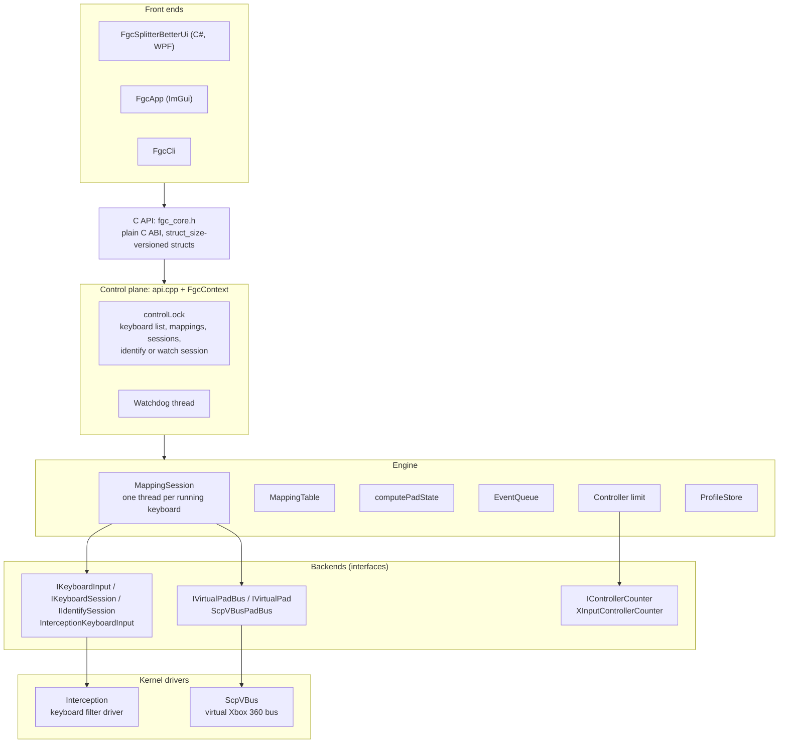
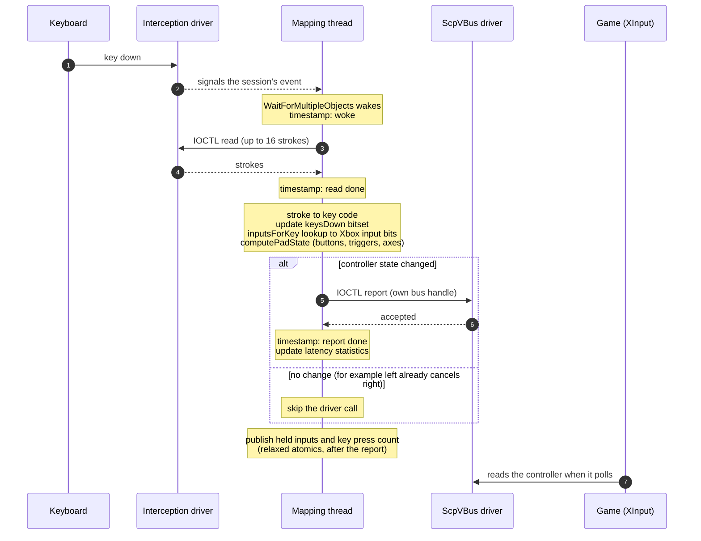
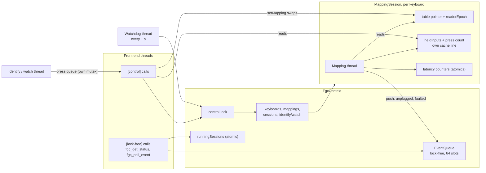
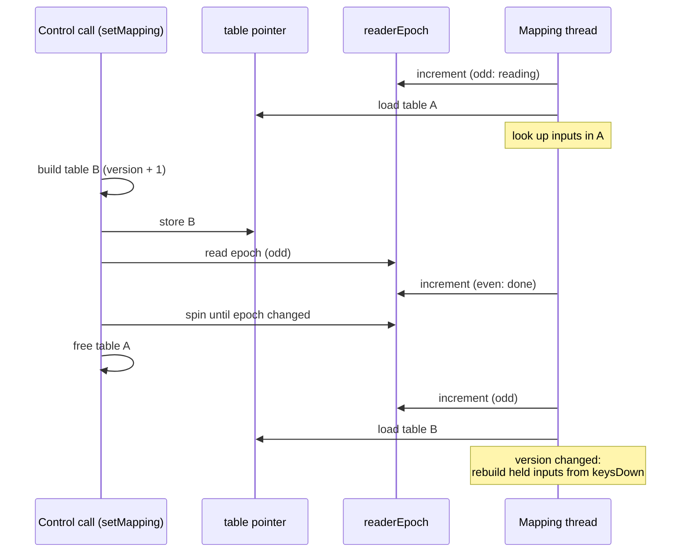
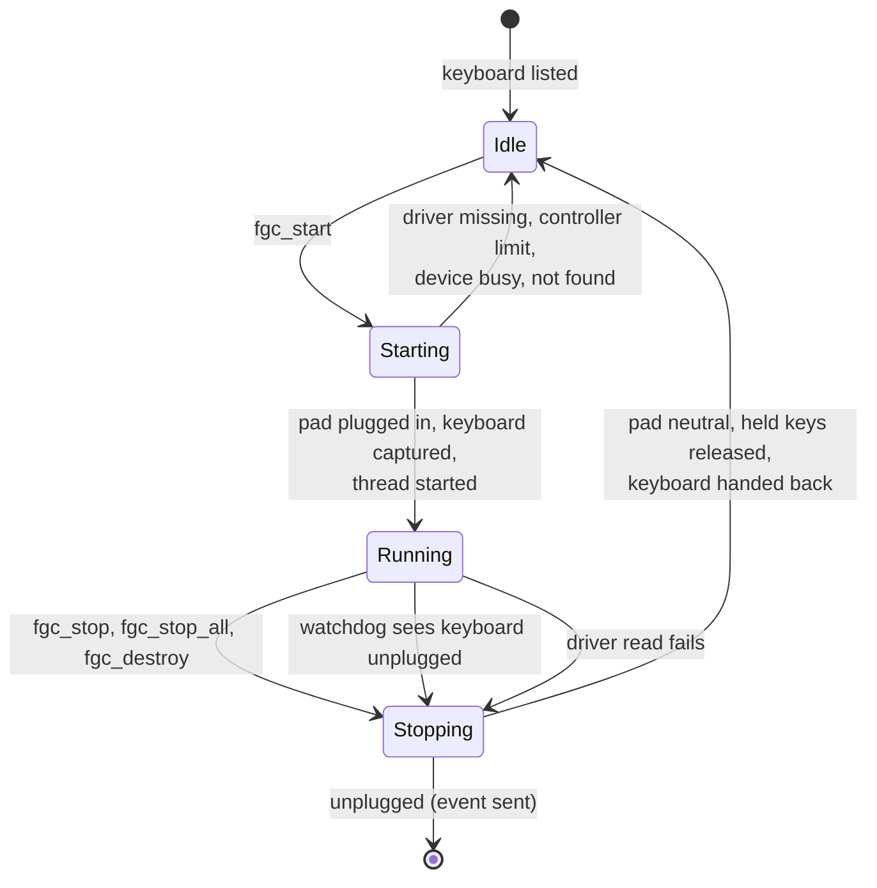
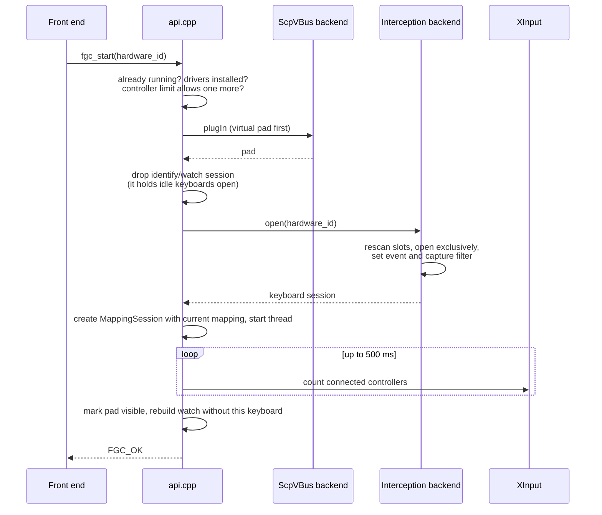
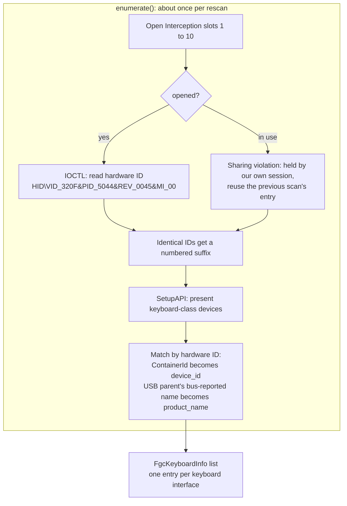
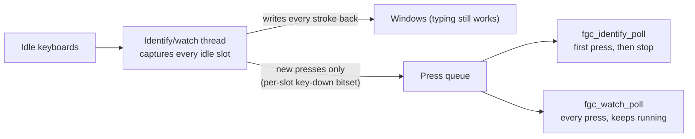
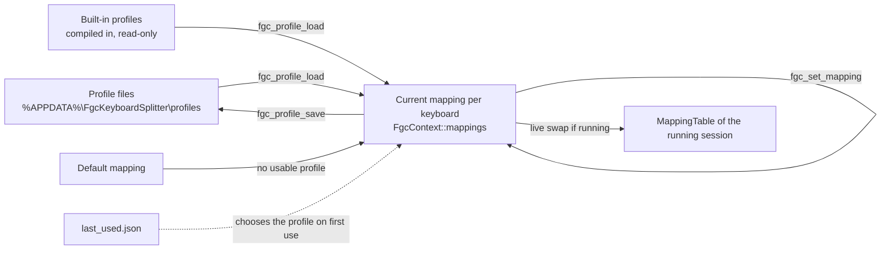

# How FgcCore works

This page explains the architecture, data flow and design of the engine, `FgcCore.dll` (the `core/` folder), for
anyone changing it or writing a front end against it. The public contract itself is
[`core/include/fgc_core.h`](../core/include/fgc_core.h); this page explains what happens behind it and why.

The engine has one goal that shapes everything else: **turn a key press into a controller update as fast and as
predictably as possible, and never leave a key or button stuck.**

- [Layers](#layers)
- [The hot path: one key press](#the-hot-path-one-key-press)
- [Threads and shared state](#threads-and-shared-state)
- [Live remapping](#live-remapping)
- [Session lifecycle](#session-lifecycle)
- [Keyboard discovery and identity](#keyboard-discovery-and-identity)
- [Controller limit](#controller-limit)
- [Profiles and mappings](#profiles-and-mappings)
- [Design decisions and trade-offs](#design-decisions-and-trade-offs)
- [Known limitations](#known-limitations)
- [Where to find things](#where-to-find-things)

## Layers

- **The C API is the only public surface.** Nothing C++ crosses it: no STL types, no exceptions, no memory the
  caller must free. Every struct starts with `struct_size`, so later releases can append fields without breaking
  older callers. Each function is labelled `[control]`, `[lock-free]` or `[create]`, which tells a front end which
  thread it may call it from (see [Threads and shared state](#threads-and-shared-state)).
- **The control plane** (`api.cpp`, `FgcContext` in `context.h`) owns all mutable state that is not on the input
  path, behind a single mutex.
- **The engine** is plain C++ with no Windows driver knowledge.
- **Every driver sits behind a small interface** (`backends/keyboard_backend.h`, `backends/pad_backend.h`,
  `backends/controller_counter.h`), so a different keyboard or virtual-pad driver would replace a backend without
  touching the engine.

## The hot path: one key press

Each running keyboard has its own `MappingSession` thread (`engine/mapping_session.cpp`), at
`THREAD_PRIORITY_TIME_CRITICAL` and in the MMCSS "Pro Audio" class. This is the whole journey of one key press:

Step by step, inside the thread:

1. **Wait.** `WaitForMultipleObjects` on two events: the session's stop event and the driver's "strokes queued"
   event. No polling, so an idle keyboard costs no CPU and a key press wakes the thread immediately.
2. **Read.** One `DeviceIoControl` reads up to 16 queued strokes into a fixed buffer.
3. **Decode.** Each stroke becomes a key code: the set-1 scan code, plus `0x100` for E0-prefixed keys (arrows,
   right Ctrl and so on). There are 512 possible codes.
4. **Track keys.** A 512-bit `keysDown` bitset records which keys are physically held. A key that goes down while
   not already held counts as a new press; key repeats from holding a key do not.
5. **Look up.** `MappingTable::inputsForKey[key]` is a 32-bit mask of the Xbox inputs that key drives: one array
   read, however many inputs are bound. The thread folds it into `held`, the set of Xbox inputs currently held.
6. **Build the controller state.** `computePadState(held)` (`engine/pad_state.cpp`) produces an
   `XINPUT_GAMEPAD`-compatible state. Buttons map directly; triggers are 0 or 255; stick directions are full
   deflection. Opposing directions are resolved here (see below).
7. **Report.** Only if the state differs from the last one sent, one `DeviceIoControl` hands it to ScpVBus.
8. **Publish.** The thread records latency (wake to report accepted, split into driver read and report call) and
   then publishes `held` and the press count for front ends.

What keeps it fast and predictable:

| Property | How |
|---|---|
| No allocation, lock or file access per key | Stroke buffer, bitset, report buffer and statistics are all preallocated members or locals |
| Constant-time mapping | The reverse table resolves a key to all of its inputs with one read |
| Keyboards never wait on each other | Each keyboard has its own Interception handle and thread; each virtual pad has its own ScpVBus handle, because synchronous IOCTLs on one handle are serialized |
| Fewer driver calls | A press that does not change the controller state skips the report |
| UI polling never delays a report | Held inputs and the press count are written after the report, on their own 64-byte cache line, with relaxed stores |

**Opposing directions (SOCD).** On the D-pad and both sticks, left + right gives neutral and up + down gives up. Keys
bound to several inputs simply set several bits, so one key can press two buttons.

## Threads and shared state

| Thread | Count | Does | Locking |
|---|---|---|---|
| Front-end callers | any | Every API call | `[control]` calls take `controlLock`; `[lock-free]` calls only touch atomics |
| Mapping thread | one per running keyboard | The hot path | **Never takes `controlLock`** |
| Watchdog | one per context | Every second: ends sessions whose keyboard was unplugged, removes finished sessions (which frees their pad slot) | Takes `controlLock` |
| Identify / watch thread | zero or one | Captures idle keyboards, hands every stroke straight back to Windows, queues key presses | A small mutex on its press queue |

The rule that makes this safe: **mapping threads never share a lock with anything.** Everything they exchange with
the rest of the engine is an atomic or a lock-free structure:

- **Events** (keyboard unplugged, session faulted) go through `EventQueue` (`engine/event_queue.h`), a bounded
  lock-free multi-producer multi-consumer queue (Vyukov's design). Front ends pop them with `fgc_poll_event`. The
  engine never calls back into a front end.
- **Status** (`runningSessions`, a session's `finished_` flag, held inputs, press count, latency) is atomics.
- **Mappings** change through the epoch scheme below.

The single `controlLock` keeps the rest simple: control calls are serialized, which is fine because none of them is
on the input path.

## Live remapping

Changing a key on a running keyboard must not stall its thread, even for a moment. `setMapping()` never waits on the
mapping thread's lock (it has none); instead the control side waits until the mapping thread is provably done with
the old table:

- The thread brackets every table read with two increments of `readerEpoch_`. An odd value means "reading now".
- After swapping the pointer, the control side reads the epoch. If it is odd, it waits for that value to change
  before freeing the old table. If it is even, no read of the old table can still be in progress.
- Each table has a version. When the thread sees a new version it recomputes `held` from the keys physically down,
  so a key held across a remap neither sticks nor drops.

## Session lifecycle

**Starting** (`fgc_start` in `api.cpp`):

- **The pad is plugged in before the keyboard is captured**, so no keystroke is ever swallowed without a controller to
  receive it.
- **Waiting for XInput to list the pad** lets the controller limit count it as this app's pad instead of another
  program's (see [Controller limit](#controller-limit)).

**Stopping** always runs the same exit path at the end of the thread: send a neutral report, tell Windows every
still-held key is up (Windows saw those keys go down before capture, or never saw their release, so they would stay
stuck down), clear the capture filter and close the handle. The keyboard types normally again immediately.

**Unplugging.** An Interception slot keeps its number after its keyboard is gone but then reports another (or no)
hardware ID. The watchdog asks each session `connected()` once a second, ends the session as "disconnected", and the
thread pushes `FGC_EVENT_KEYBOARD_DISCONNECTED`.

**Crashes.** A virtual pad left plugged by a crashed process keeps its last buttons held and its slot taken. Live pads
are registered in a global table, and an unhandled-exception filter plus a `std::terminate` handler send each one a
neutral report and unplug it. ScpVBus has one more quirk: closing *any* handle to the bus unplugs *every* pad, so
`BusHandlePool` keeps released handles open until the last pad is gone.

## Keyboard discovery and identity

- **An entry is a keyboard interface, not a physical device.** Windows gives many keyboards several interfaces (a
  second one for media keys or n-key rollover), and gaming mice expose keyboard interfaces for their macro buttons.
  Each is its own Interception slot and its own `hardware_id`.
- **`device_id`** is the interface's Windows ContainerId, which every interface of one physical device shares, so a
  front end can group them. It is empty when an identical device is also plugged in, because the hardware ID cannot
  say which interface belongs to which device.
- **`product_name`** is the name the USB device reports (for example "GMMK PRO"), read from the interface's USB
  parent, since the keyboard interface itself is only called "HID Keyboard Device".
- **A session captures one interface**: the one whose `hardware_id` was started.

### Identify and watch

Both modes find out which keyboard a key was pressed on, while the key still reaches Windows:

- **Identify** reports the first press and is meant to be cancelled afterwards (the ImGui app uses it).
- **Watch** is for "press any key to join" screens. It keeps running and follows the keyboards: `fgc_start` and
  `fgc_stop` rebuild it without or with that keyboard, and `fgc_watch_poll` rescans at most once a second (only when
  its queue is empty) to pick up newly plugged keyboards.
- Running keyboards are never in the watch (their slot is held by their session). Front ends use
  `fgc_get_key_press_count` to notice presses on them.

## Controller limit

XInput, which most games use, supports four controllers in total. `fgc_check_controller_limit` and `fgc_start`
compute whether one more fits (`engine/controller_limit.cpp`):

- XInput's connected count includes this library's own pads once Windows has listed them, so those must not be
  counted twice.
- A freshly plugged pad takes Windows a moment to appear. A pad counts as "settled" once `fgc_start` saw it appear,
  or after 3 seconds. Until then the check leans toward refusing a start rather than allowing a fifth controller.

## Profiles and mappings

- **The current mapping** of each keyboard lives in the context, may differ from any saved profile, and is what a
  session starts with. The first time a keyboard is used it comes from its last-used profile, or the default mapping.
- **Profiles** are JSON files, one folder per keyboard `hardware_id`, plus `last_used.json`. Names follow Windows
  file-name rules and compare case-insensitively. The file format is documented in `fgc_core.h`.
- **Built-in profiles** (such as "2XKO Default") are compiled in, listed first, and can be loaded but not saved over,
  renamed or deleted.
- Profiles are only read and written by control calls, never on the input path.

## Design decisions and trade-offs

| Decision | Why | Cost |
|---|---|---|
| Drive Interception and ScpVBus through their IOCTLs, not `interception.dll` | The library opens every keyboard exclusively per context (so keyboards could not have independent threads) and allocates on every call | The engine implements both drivers' protocols |
| One blocking thread per keyboard | Lowest wake-up latency; keyboards are fully isolated | A thread per running keyboard (at most four are useful) |
| One `controlLock` for all control state | Simple and obviously correct; nothing on it is time-critical | Control calls are serialized; a slow `fgc_start` (up to 500 ms waiting for XInput) blocks other control calls meanwhile |
| Front ends poll; the engine never calls back | Mapping threads never run front-end code, so a slow UI cannot slow input | Front ends need a timer |
| Capture one interface per session | One handle and one wait in the hot loop | Keys that a device sends through a second interface are not mapped |
| Report only on state changes | Fewer driver calls | None in practice |
| Pad before capture, neutral and key release on every exit, crash handlers | No swallowed input, nothing stuck, slots freed | More code on the start and stop paths |

## Known limitations

- **Identical devices** can be told apart only by a numbered `hardware_id` suffix, which depends on enumeration order,
  and they get no `device_id`.
- **An idle keyboard unplugged while watching** stays in the watch's list until the watch is next rebuilt (a keyboard
  starting or stopping, or another keyboard being plugged in).
- **The opposing-direction rule is fixed** (left + right neutral, up + down up).
- **Only XInput (Xbox 360) controllers**, because that is what ScpVBus provides.

## Where to find things

| Path | What |
|---|---|
| `core/include/fgc_core.h` | The public C API and its conventions |
| `core/src/api.cpp` | Every API function, the watchdog, start/stop and watch orchestration |
| `core/src/context.h` | `FgcContext`: everything one context owns |
| `core/src/engine/mapping_session.*` | The per-keyboard thread and the hot path |
| `core/src/engine/mapping_table.*` | Key-to-inputs reverse table, default mapping |
| `core/src/engine/pad_state.*` | Held inputs to controller state, opposing directions |
| `core/src/engine/event_queue.h` | Lock-free event queue |
| `core/src/engine/controller_limit.*` | Four-controller check |
| `core/src/backends/interception_keyboard.*` | Interception: enumeration, capture sessions, identify/watch |
| `core/src/backends/scpvbus_pad.*` | ScpVBus: pads, bus handle pool, crash handlers |
| `core/src/backends/controller_counter.*` | XInput controller count |
| `core/src/profiles/profile_store.*` | Profile files and built-in profiles |
